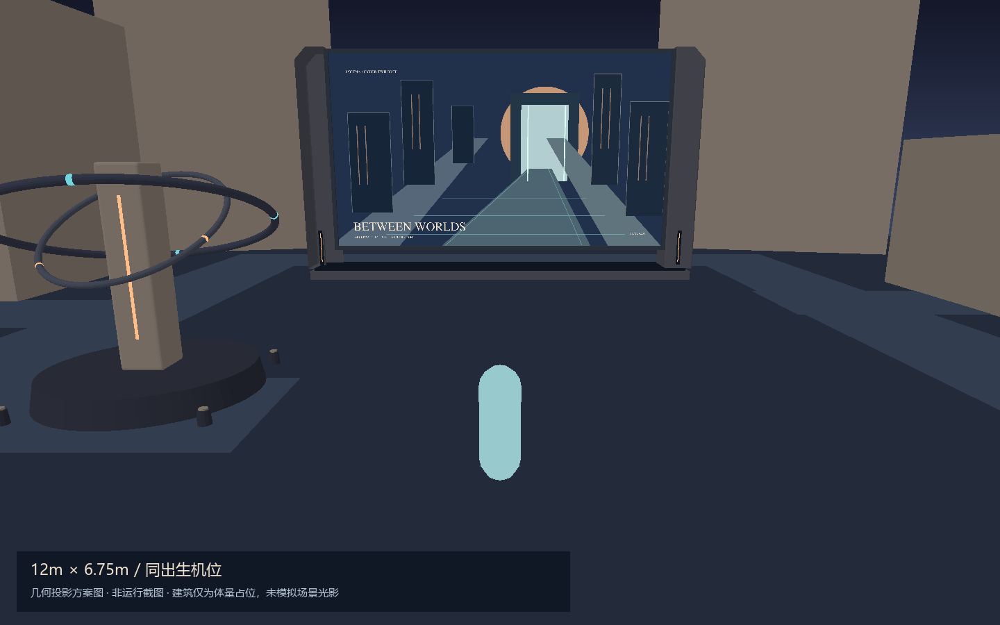
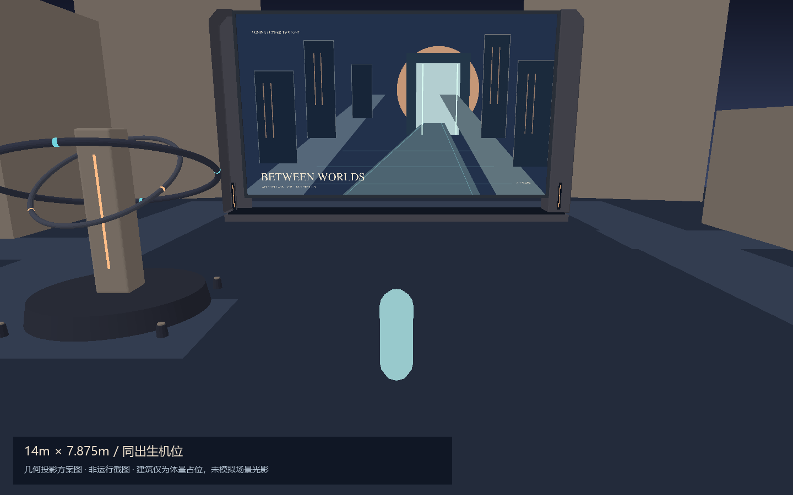
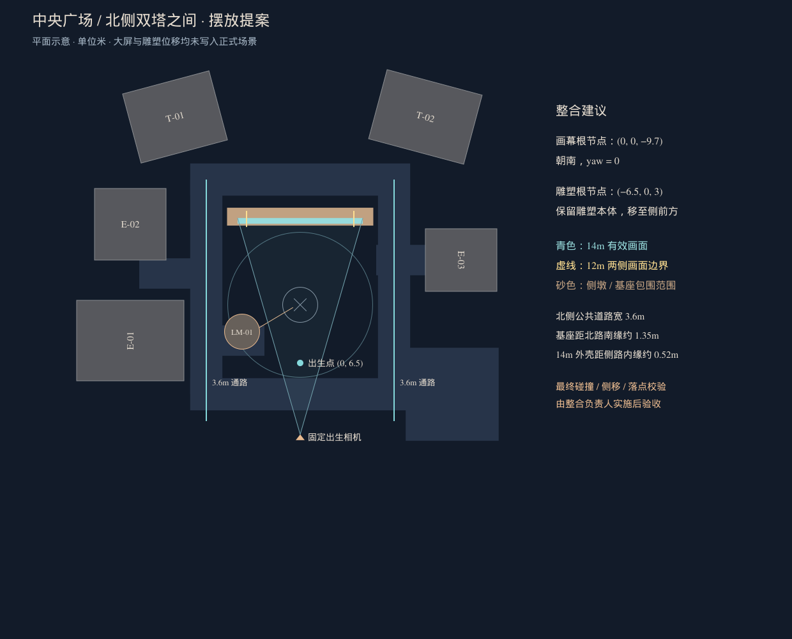

# 建筑体量艺术画幕：首轮尺寸与摆放比较

本轮停在提案阶段，等待尺寸选定后细化；没有替换正式场景的 8m 大屏。只新增自有大屏提案模块、赛博封面、评审页与输出脚本，未修改雕塑、布局、碰撞、共享 WorldEngine、公共引擎或正式大屏的接口。

## 同出生机位比较

| 候选 | 有效画面 | 总体宽度（含侧墩） | 画面上沿距视口顶部 | 特点 |
| --- | --- | --- | --- | --- |
| A | 12 × 6.75m | 约 14.36m | 约 76px | 构图余量较多，侧路更宽松 |
| B | 14 × 7.875m | 约 16.36m | 约 26px | 更接近广场地标，默认上沿较紧 |

对比固定为 1440×900，直接读取当前 FollowCamera 默认参数和 SPAWN：相机 `(0, 4.15717, 14.48739)`、FOV=52°、向下 13°。两档只改画幕有效宽高，位置、画面下沿、支撑厚度、基座与相机条件保持一致。14m 地标感更强，可优先作为候选；顶部余量较小，不应把投影角点在画面内等同于视觉已经通过。





这两张是 CPU 深度缓冲生成的几何投影方案图，**不是浏览器运行截图**。大屏与雕塑使用提案和现有模块的真实几何；建筑只取现有布局包围体，人物为尺寸占位。材质仅做示意着色，未还原真实环境光、阴影、雾、玻璃和完整立面，不能据此判定最终亮度或网页观感。画幕四角投影值见 `projection-checks.json`。

## 外观方向与接口

`src/worlds/cyberpunk/props/artCurtainProposal.ts` 导出 `createArtCurtainProposal(spec, anisotropy)`，保留 `group / dispose` 交接形式。宽高、位置、朝向和封面继续由 PlazaScreenSpec 参数传入。现有正式模块和任何打开/关闭事件均未改动；没有新增世界切换逻辑。

两侧为约 0.95m 宽、1.25m 深的切角厚墩，连续低基座高 0.4m，画面下沿为 1.2m。边框宽 0.14m、壳体厚 0.64m；中间无立柱，两处短灯槽留在侧墩下部。当前仅是体量级制作，不先细化后盖设备、紧固件等细节。

赛博封面为仓库原生 SVG `public/assets/worlds/cyberpunk/media/plaza-cyber-curtain.svg`：暮蓝、砂岩、琥珀光与少量青色，采用建筑门洞和透视街道作为主体。旧山景 `plaza-screen.svg` 原样保留，可由未来田园主题引用，本轮不创建新世界或重绑正式内容。

## 中央广场摆放提案（未应用）



- 画幕根节点建议 `(0, 0, -9.7)`、yaw=0，位于广场北侧、双塔之间，正面朝南。
- 雕塑建议从原点移到 `(-6.5, 0, 3)`，作为侧前方景物。仅预览页临时移动副本，不写正式布局。
- 14m 方案的外壳距侧路内缘约 0.52m；基座北侧距北路南缘约 1.35m，均基于当前平面尺寸推算。
- 两侧主路仍为现有 3.6m 路宽。雕塑整体旋转扫掠、灯具、座椅、花箱、跳跃落点和镜头碰撞，需整合负责人应用后逐项复核。

整合负责人选定尺寸后负责：正式布局与雕塑位置、外壳/侧墩/连续基座碰撞、快照安全落点与复位、保持既有打开关闭入口、真实出生画面的遮挡及行走验收。旧双细腿碰撞不能直接用于新侧墩和连续基座。本轮未冒充这些整合工作已经完成。

## 独立真实场景预览与验证状态

开发服务启动后打开：

`http://127.0.0.1:5173/docs/plaza-screen-review/proposal.html`

该页读取当前真实场景，以冻结出生相机切换 12m / 14m，并可临时切回中央雕塑检查遮挡；不启动移动模拟，不保存提案位置。它是评审工具，没有接入正式路由。

已执行 `scripts/capture-art-curtain-proposal.py`，Playwright 在创建驱动管道时遭遇 `PermissionError: [WinError 5]`，未进入浏览器，因此两档 **WebGL 同机位截图未交付**。失败记录在 `browser-checks.json`。真实场景预览页仍待浏览器执行确认。

生成方案图的命令：

```powershell
& '.\node_modules\@esbuild\win32-x64\esbuild.exe' scripts/render-art-curtain-proposal.ts --bundle --platform=node --format=esm --packages=external --outfile=.camera-preview/render-art-curtain.mjs
node .camera-preview/render-art-curtain.mjs
python scripts/raster-art-curtain-proposal.py
```

`raster-art-curtain-proposal.py` 使用本机现有 PyMuPDF、NumPy、Pillow，不增加项目运行依赖。PNG 为有深度缓冲的正式方案图；早期 SVG 仅为矢量生成中间件，不能替代 PNG 的遮挡结果。
